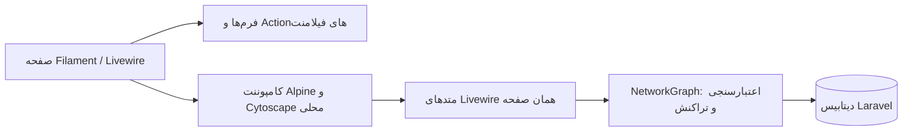

# مدیریت شبکه بومی Filament 3

ادیتور شبکه یک صفحه Livewire/Filament در همین پروژه Laravel است. هیچ iframe، بک‌اند Python، API پروژه Homelable، CDN یا سرویس خارجی برای اجرای پنل لازم نیست. Homelable فقط مرجع بررسی قابلیت‌ها بود. ترسیم با Cytoscape.js و Alpine انجام می‌شود؛ همه کتابخانه‌ها داخل پروژه build و از همین سرور ارائه می‌شوند.

## اجرا

```powershell
.\start.ps1
```

پنل: http://127.0.0.1:8000/admin/networks

حساب مدیر را هنگام نصب با `php artisan make:filament-user` بسازید؛ رمز پیش‌فرض مشترکی وجود ندارد.

برای آماده‌سازی وابستگی‌های پروژه پس از انتقال:

```powershell
php scripts/prepare-environment.php
composer install
npm.cmd ci
npm.cmd run build
php artisan migrate
php artisan db:seed --class=NetworkDemoSeeder
php artisan make:filament-user
```

اسکریپت `setup-network.ps1 -Demo -CreateAdmin` تنظیمات، کلید، دیتابیس، وابستگی‌ها، داده نمونه و حساب مدیر را آماده می‌کند. راهنمای نصب تازه در [README](../README.md) است.

Seeder نمونه قابل تکرار است و نقشه نمونه ویرایش‌شده را بازنویسی نمی‌کند.

## امکانات پیاده‌شده

- هر شبکه بوم مستقل و خالی خودش را دارد؛ دیاگرام نمونه به شبکه‌های تازه کپی نمی‌شود.
- تجهیزات با انواع روتر، فایروال، سوییچ، سرور، VM، Docker، NAS، رایانه، SIEM، EDR و غیره.
- فهرست مستقل تجهیزات: تجهیز را بدون نقشه بسازید؛ در بوم «افزودن تجهیز» را بزنید و با نام، IP یا Hostname انتخاب کنید. «تجهیز جدید» فرم ساخت جداگانه است.
- هر تجهیز می‌تواند در چند نقشه با جایگاه و ارتباط‌های مستقل نمایش داده شود. انتخاب دوباره در یک بوم فقط همان تجهیز را پیدا می‌کند. حذف از بوم یا حذف شبکه، تجهیز را از فهرست پاک نمی‌کند.
- فرم‌های بومی فیلامنت برای IP، hostname، MAC، سیستم‌عامل، سخت‌افزار، برچسب، ویژگی دلخواه، سرویس و یادداشت.
- ارتباط بین تجهیزات با نوع، VLAN، سرعت، پورت مبدا و مقصد، رنگ، ضخامت، خط‌چین، جهت و حرکت روی خط.
- ناحیه، متن، گروه‌بندی تجهیزات زیر ناحیه/میزبان، جمع و باز کردن گروه.
- قاب رک ساده و مشخص کردن یونیت شروع و ارتفاع U تجهیزات؛ هم‌پوشانی یونیت‌ها در سرور بررسی می‌شود. نمایش رک در همین بوم است و کپی کامل طراحی فیزیکی Homelable نیست.
- جابه‌جایی، pan/zoom، انتخاب چندتایی، جستجو، تراز، چیدمان خودکار عمودی/افقی/شبکه‌ای، چهار تم و نمای کوچک.
- بازگشت/انجام مجدد، کپی/چسباندن، تکثیر، حذف و حالت فقط مشاهده.
- ذخیره دستی، ذخیره خودکار اختیاری، بازیابی پس از Refresh و نگهداری ۲۰ نسخه آخر.
- خروجی JSON، YAML، PNG، SVG و Markdown؛ ورود JSON/YAML خروجی همین ادیتور. ورود فایل یک پیش‌نمایش روی بوم است و تا زدن ذخیره، دیتابیس تغییر نمی‌کند.
- ریسورس بومی «فهرست تجهیزات» با فیلتر شبکه و نوع و ویرایش مشخصات.
- کپی کامل شبکه با شناسه‌های جدید و حفظ اتصال‌ها و گروه‌بندی.

## مواردی که خودکار نیستند

وضعیت تجهیزات و سرویس‌ها **دستی** است و در فرم مشخص شده. هیچ ping، اسکن شبکه، health check، اتصال Proxmox/UniFi/MQTT، اجرای n8n یا اقدام SOAR ارسال نمی‌شود. هدف این نسخه، مدیریت و ترسیم نقشه در خود فیلامنت با اجرای مستقل است. همه قابلیت‌های محصول Homelable بازسازی نشده‌اند؛ قابلیت‌های بالا محدوده واقعی این پیاده‌سازی‌اند.

فایل JSON/YAML پروژه اصلی Homelable، فرمت این ادیتور نیست. نقشه‌های نمونه اتصال قبلی یک بار از SQLite محلی به مدل‌های جدید منتقل شدند؛ سازگاری عمومی با تمام فرمت‌ها و رک‌های Homelable ادعا نمی‌شود.

## ارائه به سرتیم

1. نقشه `توپولوژی نمونه | دو رک و اتصال پورت‌ها` را باز کنید؛ شامل شش تجهیز، دو رک و پنج اتصال است.
2. یک شبکه تازه بسازید؛ بوم خالی است. دو تجهیز با فرم فیلامنت اضافه کنید.
3. یکی را جابه‌جا کنید، «اتصال» را فعال کنید و مبدا و مقصد را انتخاب کنید؛ یا روی بوم از مبدا به مقصد بکشید.
4. ناحیه اضافه کنید و در فرم تجهیز آن را به‌عنوان والد انتخاب کنید.
5. ذخیره و Refresh کنید. شبکه دیگری بسازید تا استقلال داده‌ها مشخص شود.
6. خروجی تصویر و YAML و تاریخچه را نشان دهید. ریسورس تجهیزات نیز همین داده‌ها را می‌خواند.

نقشه آماده شامل آدرس‌های مستنداتی و تجهیزات نمایشی است؛ وضعیت زنده شبکه شرکت را نشان نمی‌دهد.

## معماری و فایل‌ها



| فایل یا جدول | کاربرد |
| --- | --- |
| `app/Filament/Resources/NetworkResource` | صفحات شبکه و فرم‌های بومی |
| `app/Filament/Resources/EquipmentResource.php` | فهرست تجهیزات |
| `resources/views/filament/resources/network-resource/pages/network-map.blade.php` | کامپوننت بوم |
| `resources/js/network-editor.js` | تعاملات ترسیم، تاریخچه محلی و خروجی‌ها |
| `resources/css/network-editor.css` | ظاهر محلی و تم‌ها |
| `app/Services/NetworkGraph.php` | ذخیره/بازیابی، اعتبارسنجی، کپی شبکه و نسخه‌ها |
| `networks` | مشخصات، تنظیمات، viewport و شماره نسخه |
| `equipment` | هویت و مشخصات مشترک تجهیزات، مستقل از نقشه |
| `network_nodes` | جایگاه و ظاهر تجهیز در هر شبکه با `equipment_id`؛ همچنین ناحیه‌ها، رک و متن |
| `network_edges` | ارتباط‌های همان شبکه |
| `network_versions` | حداکثر ۲۰ ذخیره آخر هر شبکه |
| `public/network-editor` | فایل‌های ساخته‌شده و محلی مرورگر |

هر ذخیره تراکنشی است. دو سر ارتباط و والدها باید متعلق به همان نقشه باشند. چرخه گروه‌بندی، شناسه مشترک با شبکه دیگر و هم‌پوشانی یونیت رک رد می‌شوند. اگر نقشه در پنجره دیگر یا ریسورس تجهیزات تغییر کرده باشد، ذخیره قدیمی اجازه بازنویسی ندارد؛ تغییرات روی بوم می‌مانند تا خروجی بگیرید یا نسخه سرور را باز کنید.

نام، نوع، IP و دیگر مشخصات تجهیز بین نقشه‌ها مشترک‌اند؛ ویرایش آن‌ها در فهرست یا نقشه، در همه نقشه‌های مرتبط نمایش داده می‌شود. مختصات، رنگ، والد و یونیت رک مخصوص هر نقشه‌اند. انتخاب تجهیز بدون ذخیره نقشه، تغییری در دیتابیس ایجاد نمی‌کند. نسخه مشخصات تجهیز نیز هنگام ذخیره بررسی می‌شود تا انتخاب قدیمی، ویرایش جدید فهرست را بازنویسی نکند. مهاجرت `000005` تجهیزات قبلی را با همان شناسه و بدون تغییر جایگاه به فهرست مستقل منتقل می‌کند.

کپی یک شبکه، همان تجهیزات را با جایگاه‌های جدید در نقشه کپی‌شده نمایش می‌دهد. کپی/چسباندن تجهیز در همان بوم و ورود فایل، تجهیزات مستقلی می‌سازند؛ فایل ورودی به شناسه‌های موجود فهرست متصل نمی‌شود. تاریخچه‌ای که نسخه قدیمی مشخصات یک تجهیز را داشته باشد، برای بازنویسی مشخصات جدید باید ابتدا با نسخه فعلی هماهنگ شود.

پوشه‌های `reference/homelable` و `reference/legacy-integration` فقط مرجع محلی‌اند و از Git کنار گذاشته شده‌اند. برای نصب و اجرای نسخه بومی لازم نیستند.

## تست

```powershell
php artisan test
npm.cmd install --prefix storage/browser-tools playwright --no-audit --no-fund
$env:BROWSER_EMAIL = 'your-local-admin-email'
$env:BROWSER_PASSWORD = 'your-local-admin-password'
node tests/Browser/native-smoke.cjs
node tests/Browser/native-roundtrip.cjs
node tests/Browser/native-advanced.cjs
node tests/Browser/native-equipment.cjs
```

تست مرورگر Chrome محلی را استفاده می‌کند و درخواست به همه originهای دیگر را مسدود می‌کند. وجود iframe و درخواست خارجی خطا محسوب می‌شوند. تست roundtrip نقشه‌های موقت خود را در پایان حذف می‌کند. تست‌های Laravel مستقل بودن داده‌ها، اعتبارسنجی، ذخیره همزمان، فرم‌ها، کپی و حذف شبکه و تاریخچه را پوشش می‌دهند.

## انتقال به شرکت

این پیاده‌سازی در پروژه نمونه انجام شده است؛ تطبیق با مدل تجهیزات، نقش‌ها، Policyها، جداسازی سازمان و داده‌های موجود شرکت هنوز باید براساس کد واقعی شرکت انجام شود. در نمونه، کاربران واردشده پنل از فضای مشترک شبکه‌ها استفاده می‌کنند. این بخش صرفاً نقشه را مدیریت می‌کند و جایگزین موتور پاسخ SOAR نیست.

برای حفظ حدود مسئولیت در ارائه، عنوان دقیق نتیجه «نمونه مدیریت شبکه و ادیتور بومی Filament با الهام از قابلیت‌های Homelable» است.

## کتابخانه‌ها

هسته ترسیم [Cytoscape.js](https://js.cytoscape.org/) و افزونه‌های dagre، edgehandles و SVG از npm در همین پروژه نصب شده‌اند. js-yaml ورود و خروج YAML را انجام می‌دهد. مجوزها در بسته‌های نصب‌شده حفظ می‌شوند و نسخه‌ها در `package-lock.json` قفل شده‌اند. هیچ کد رابط یا سرور Homelable در ادیتور بومی import نمی‌شود.
